<b>🔴 &nbsp;Click to expand — the long version</b>

 

- 🧠 &nbsp;I build **AI-native tools** — multi-agent desktops where Claude Code, Codex & friends work side by side on an infinite canvas.
- 🏥 &nbsp;I ship **real-world business software** — pharmacy ERPs, HR time & attendance with biometric terminals.
- 🛰️ &nbsp;I run **my own infra** — automated server backups to S3 / Oracle Cloud, VSS retention, Proxmox, web restore.
- 🎙️ &nbsp;Obsessed with **voice-first UX**: local STT/TTS, streaming synthesis, real barge-in. No cloud required.
- ⚡ &nbsp;Philosophy: *local-first, fast, and built to actually be used.*

<b>🔒 &nbsp;In the lab — private builds</b>

 

| Project | What it does | Stack |
|:--|:--|:--|
| ⏱️ **Time & Attendance** | HR attendance platform with fingerprint / face terminal support | JavaScript |
| 🗄️ **Backup Orchestrator** | Server backups to S3-compatible storage & Oracle Cloud, VSS retention, Proxmox, web restore | Python |
| 🖥️ **ORCH Desktop** | Native desktop build of ORCH | Tauri · TypeScript |
| 🎼 **Orchestra** | Agent orchestration experiments | TypeScript |

 

<picture>
  <source media="(prefers-color-scheme: dark)" srcset="https://raw.githubusercontent.com/reedonee/reedonee/output/github-snake-dark.svg"/>
  
</picture>

